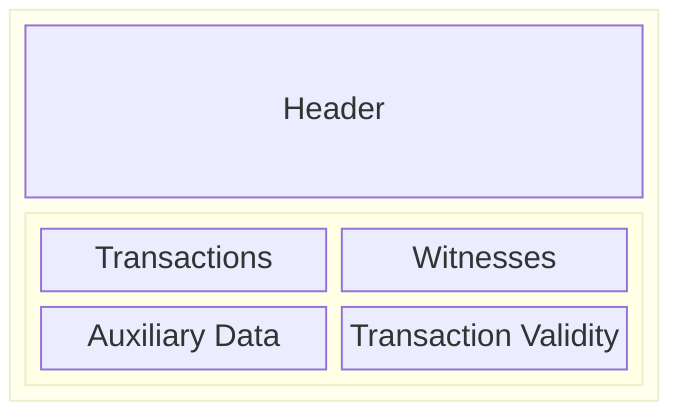

# Ledger: Blocks

Blocks are a fundamental component of all blockchains and represent one of two
basic units of exchange between nodes (the other being [transactions](./transactions.md)).

A block can itself be broken down into multiple parts:



See also the [Block CDDL](https://github.com/IntersectMBO/cardano-ledger/blob/master/eras/conway/impl/cddl/data/conway.cddl#L8) for the Conway era (the latest era at the time of writing).

## The header/body split

The most important distinction in the above diagram is that there is a split
between the header of the block and the body. The general guiding principle
behind this is the following:

- The *header* contains the parts of the block relevant to the consensus
  protocol.
- The *body* contains the parts of the block relevant to the ledger.

The full details and implications of this split are covered in
[Implications of the Header/Body Split](../constraints/header-body-split.md).
For now, we can assume that the contents of the header are not important for
the ledger processing.

<div class="leios">

Leios re-uses block headers as announcements of endorser blocks (EBs), via an
`eb_references_announcement` field. A `block_body_contains_leios_cert` flag
tells whether the body certifies an EB instead of carrying transactions (see
[below](#changed-dijkstra-block)).

```cddl
{{#include ../eras/dijkstra.cddl:58:71}}
```

with

```cddl
{{#include ../eras/dijkstra.cddl:105:108}}
```

</div>

## The header hash

A block is identified by the hash of its header: `prev_hash` in the next header
and the points exchanged between peers refer to it. It is the Blake2b-256 hash
of the whole `header` exactly as received, that is, of the encoded
`[header_body, body_signature]`.

CBOR admits several encodings of the same value, for example definite- and
indefinite-length arrays, and the decoders accept them. So one header can be
relayed under several hashes. What the signature covers is described under
[Chain validity](../../consensus/chainvalid.md#ouroboros-praos), and why such
copies are harmless for Praos under
[Chain selection](../../consensus/chainsel.md#tie-breakers-in-praos-and-older-protocols).

<div class="leios">

From Dijkstra on, the header hash covers only what the block producer signed:

```
header_hash = blake2b_256(original_bytes(header_body) || raw_bytes(body_signature))
```

where `original_bytes(header_body)` is the encoded `header_body` exactly as
received, and `raw_bytes(body_signature)` is the content of the `kes_signature`
byte string, without its CBOR head. As the signature is verified over those same
`header_body` bytes (see [Chain validity](../../consensus/chainvalid.md#ouroboros-praos)),
changing any of them invalidates it, and the encoding of the enclosing array no
longer enters the hash.

The signature scheme need not produce unique signatures: only the signer can
make another valid signature for the same `header_body`, so a second header hash
still means the block producer signed twice. Leios relies on this, as it
identifies [announcements](../../network/node-to-node/leios-notify/README.md#identifying-announcements)
by their header hash.

</div>

## The block body

The block body itself is split into four parts. This division is not conceptually
necessary but is helpful for efficient processing:

1. The 'Transactions' section contains the bodies of all transactions. This is
   the only part of the block body necessary to compute the resulting ledger
   state (see [The ledger state transition](../state-transition.md)) - that is,
   provided that the block is _valid_ with regard to some _ledger state_, the
   resulting new state can be computed using only the data in this section.

1. The 'Witnesses' section contains the cryptographic witnessing necessary to
   evaluate the _validity_ of the transactions contained in the block. For
   more details on _validity_, please see the [Validity](../state-transition/validity.md)
   section.

1. The 'AuxData' section contains "auxiliary data" which is not processed
   as part of the ledger state. It instead contains data which may be of use
   to either users directly or other software interfacing with the chain. In
   Shelley, this was limited to "metadata', which were indeed simply binary
   blobs. In the Mary and Alonzo eras slightly more structure was provided to
   allow including native and Plutus scripts respectively.

1. The transaction validity contains a list of transactions in this block which
   are [phase-2 invalid](../state-transition/validity.md). This is held
   separately since this map is provided, effectively, by the node which
   created the block, rather than by the creators of the transactions.

<div class="leios">

### Changed dijkstra block

A block may certify an EB. It then sets `block_body_contains_leios_cert` in the
header and contains a `leios_certificate` instead of transactions in the body.
How the committee behind such a certificate is derived, and how the certificate
is verified against it, is described under
[Leios key registration and committee selection](../../consensus/leios-committee.md).

```cddl
{{#include ../eras/dijkstra.cddl:110:114}}
```

with

```cddl
{{#include ../eras/dijkstra.cddl:937:942}}
```

</div>
