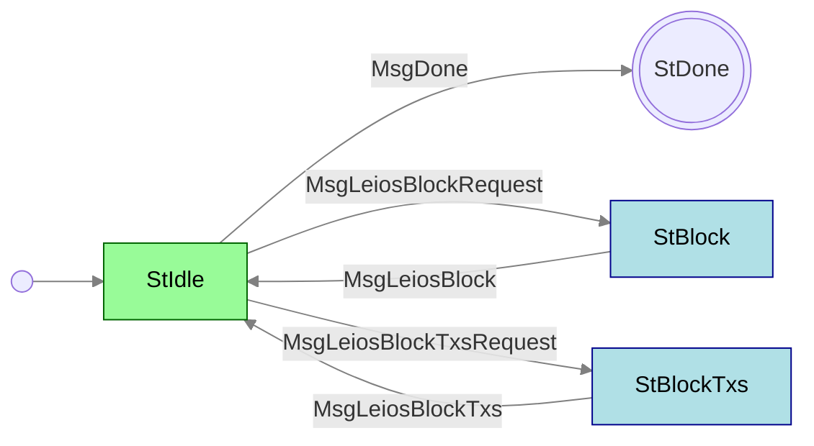

# LeiosFetch

**Mini-protocol number: 19**

`LeiosFetch` is the mini-protocol responsible for fetching Endorser Blocks (EBs)
and their transaction payloads from peers. It is a pull-based protocol: the
client explicitly requests either a full EB or a subset of its transactions
(identified by a bitmap), and the server streams the response.

EBs are discovered via [LeiosNotify](../leios-notify/README.md); once a node
decides it wants a block or its transactions, it uses `LeiosFetch` to retrieve
the data.

## State machine



### State agencies

| State      | Agency                                          |
| :--------- | :---------------------------------------------- |
| StIdle     | <span class="agency-initiator">Initiator</span> |
| StBlock    | <span class="agency-responder">Responder</span> |
| StBlockTxs | <span class="agency-responder">Responder</span> |

### State transitions

| From state | Message                 | Parameters         | To state   |
| :--------- | :---------------------- | ------------------ | :--------- |
| StIdle     | MsgDone                 |                    | End        |
| StIdle     | MsgLeiosBlockRequest    | `point`            | StBlock    |
| StBlock    | MsgLeiosBlock           | `endorser_block`   | StIdle     |
| StIdle     | MsgLeiosBlockTxsRequest | `point`, `bitmaps` | StBlockTxs |
| StBlockTxs | MsgLeiosBlockTxs        | `tx_list`          | StIdle     |

## Codecs

The messages depicted in the state machine follow this CDDL specification:

```cddl
;; messages.cddl
{{#include messages.cddl}}
```

### Encoding

Several encodings satisfy the CDDL. Nodes write exactly one, and accept any
the CDDL admits, within the size limits below.

- Every message, `point` and `tx_list` is a definite-length array. Integers
  and lengths take their shortest form.
- `endorser_block` is tag 24 around a definite-length byte string holding the
  endorser block exactly as its producer serialised it.
- Each transaction in `tx_list` is tag 24 around a definite-length byte string
  holding the transaction in its block encoding.
- `bitmaps` is an indefinite-length map. Its indices ascend strictly, stay
  below ⌈max transactions per endorser block / 64⌉, and map to non-zero
  bitmaps. The most significant bit of the bitmap at index `i` names
  transaction `64·i`, the least significant `64·i + 63`.
- `MsgLeiosBlockTxs` carries every requested transaction, in ascending order
  of offset. A server that does not hold one of them closes the connection
  instead of replying in part.

A `MsgLeiosBlock` is thus at most the maximum endorser block size plus 10
bytes. Clients request at most 500 kB of transactions at a time; this is not a
protocol parameter, and servers need not enforce it.

### Rationale

- **CBOR-in-CBOR.** An endorser block's hash, and a transaction's, is over its
  exact bytes. Wrapped, they travel unchanged: a server sends the bytes it
  stores without decoding them, and a client checks the hash and size, both
  known before decoding, before it decodes anything.
- **No era tag or version.** Both sides know the era from the slot of the
  announcing block, as an endorser block is certified only in its own era.
  Whoever decodes the bytes, for voting or block application, decodes them
  for that era.
- **Block encoding of transactions.** It carries the `is_valid` flag, which
  the mempool encoding lacks.
- **Definite lengths, shortest forms.** The framing around the payloads then
  has a known size, so the byte limits per state can be tight, and a
  declared count above its bound is rejected before anything is allocated.
- **An indefinite-length bitmap map.** Kept as first specified; a definite
  length would save at most one byte.

> [!NOTE]
>
> Catch-up oriented batch requests were once expected here
> (`MsgLeiosBlockRangeRequest` and its replies). They were never implemented
> and are no longer planned, so they are not specified.
