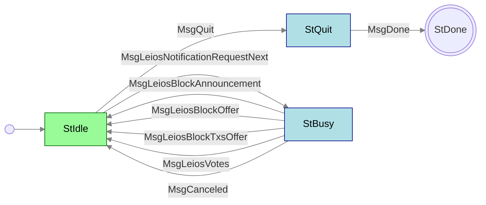

# LeiosNotify

**Mini-protocol number: 18**

`LeiosNotify` is the mini-protocol responsible for announcing Endorser Blocks
(EBs) and offering EB bodies and their associated transaction closures to peers.
It is a pull-based protocol: the client drives progress by requesting the next
notification, and the server replies with whatever is available.

Leios introduces Endorser Blocks as a mechanism to endorse and achieve consensus
on transaction inclusion independently and overlayed on the Praos block chain.
`LeiosNotify` is the dissemination layer that lets peers discover new EBs before
fetching them via [LeiosFetch](../leios-fetch/README.md). The protocol is
intended to run in a pipelined fashion where the client issues multiple
`MsgRequestNext` even before receiving a notification, so that the server can
push announcements to downstream peers with minimal latency.

A node relays what it receives over `LeiosNotify` to its own downstream peers,
and holds its upstream peers to the [protocol rules](#protocol-rules) below.
Which announcements and votes it relays, and for how long, is the subject of
[Relaying Leios announcements and votes](../../../consensus/leios-relaying.md).

## State machine



### Terminating

The client cannot simply stop. It only has agency in `StIdle`, and a request
leaves it in `StBusy` awaiting a reply the server may have no reason to send:
under light load there may be nothing to announce for a long while. A node
being demoted from hot to warm has a bounded time to shut the protocol down
cleanly, and losing that race costs the whole connection rather than just this
mini-protocol.

Two messages resolve that. `MsgQuit` lets the client declare it is leaving
without first draining the replies it has outstanding -- it may be pipelining
many requests, and waiting for each in turn would make shutdown latency a
function of pipeline depth. `MsgCanceled` then lets the server answer each of
those requests with "nothing for you" and hand agency back, so the client is
never stranded in `StBusy`. The server closes with `MsgDone`, so termination is
a two-step handshake rather than a unilateral act by either side.

### State agencies

| State  | Agency                                          |
| :----- | :---------------------------------------------- |
| StIdle | <span class="agency-initiator">Initiator</span> |
| StBusy | <span class="agency-responder">Responder</span> |
| StQuit | <span class="agency-responder">Responder</span> |

### State transitions

| From state | Message                         | Parameters         | To state |
| :--------- | :------------------------------ | ------------------ | :------- |
| StIdle     | MsgQuit                         |                    | StQuit   |
| StQuit     | MsgDone                         |                    | End      |
| StIdle     | MsgLeiosNotificationRequestNext |                    | StBusy   |
| StBusy     | MsgLeiosBlockAnnouncement       | `announcement`     | StIdle   |
| StBusy     | MsgLeiosBlockOffer              | `point`, `eb_size` | StIdle   |
| StBusy     | MsgLeiosBlockTxsOffer           | `point`            | StIdle   |
| StBusy     | MsgLeiosVotes                   | `[1* vote]`        | StIdle   |
| StBusy     | MsgCanceled                     |                    | StIdle   |

## Protocol rules

Each rule below describes something an honest node never does. A node that
finds its peer breaking one disconnects from it. Without these rules, a peer
could send arbitrarily many bogus messages, each of which the node would have
to process, and might relay. Where a rule depends on the wall clock, its bound
is wider than what an honest node sends by enough to absorb clock skew and
transmission time, so that an honest peer is never disconnected.

The rules are judged per peer: whether a peer sent something before depends
only on what that peer sent, not on what the node received from other peers.

### Requests and termination

- A client has at most 1000 `MsgLeiosNotificationRequestNext` outstanding. A
  server disconnects a client that sends more.
- A server sends `MsgCanceled` only in reply to the requests that were
  outstanding when the client sent `MsgQuit`.

### Announcements

The announcement in `MsgLeiosBlockAnnouncement` is an RB header. A client
disconnects its peer if the announcement

- does not announce an EB;
- is one the peer has announced before, or the third of its election, i.e. of
  the slot and the pool that issued it -- a second one exposes an equivocation,
  which honest nodes relay, and a third one adds nothing;
- fails protocol-level header validation out of the context of a chain: the
  election proof, the KES signature and the header's size, but not that its
  operational certificate counter is at most one more than the last one seen,
  which only a chain can tell;
- is in a slot outside the forecast range of the client's immutable tip, or
  before it;
- is from the future, by more than the clock skew a node tolerates, as
  ChainSync judges a header. One from the near future is delayed until its slot
  begins;
- arrives more than 10 minutes after its slot began. A node relays an
  announcement only until 5 minutes after its slot began.

### Offers

A client disconnects its peer if a `MsgLeiosBlockOffer` or
`MsgLeiosBlockTxsOffer`

- offers an EB that the peer has not announced to it;
- is the peer's second offer of the same kind for that EB;
- is for a slot before the client's immutable tip;
- for `MsgLeiosBlockOffer`, claims a size of zero, or more than the ledger
  allows an EB to have in that slot.

### Votes

A client disconnects its peer if a vote in `MsgLeiosVotes`

- is for an announcing RB that the peer has not announced to it, which also
  rules out a vote in a slot without Leios;
- is the peer's second vote of the same seat in the same slot;
- arrives before its voting period begins, $3 L_\text{hdr}$ after its slot
  began, by more than the clock skew a node tolerates;
- arrives after its deadline, $3 L_\text{hdr} + L_\text{vote} + L_\text{diff}$
  after its slot began, by more than a grace of 60 seconds, or is in a slot
  before the client's immutable tip;
- is for a seat that holds no key in its election's committee, or its signature
  does not verify under that key. A node need only verify a vote of a seat it
  has no vote of yet, as it relays only the first valid vote of a seat in a
  slot; see
  [Relaying Leios announcements and votes](../../../consensus/leios-relaying.md).

A vote that arrives early, but within the clock skew, is valid, and a node
relays it once its voting period has begun by its own clock. A vote that
arrives after its deadline, but within the grace, is valid too, but too late
to relay or count.

## Codecs

The messages depicted in the state machine follow this CDDL specification:

```cddl
;; messages.cddl
{{#include messages.cddl}}
```

> [!NOTE]
>
> See [CIP-0164](https://github.com/cardano-foundation/CIPs/tree/master/CIP-0164#leios-mini-protocols)
> for the rationale behind these messages.
